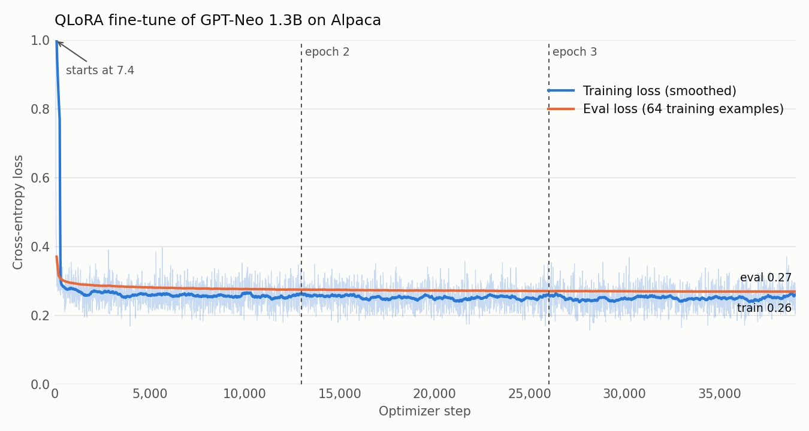
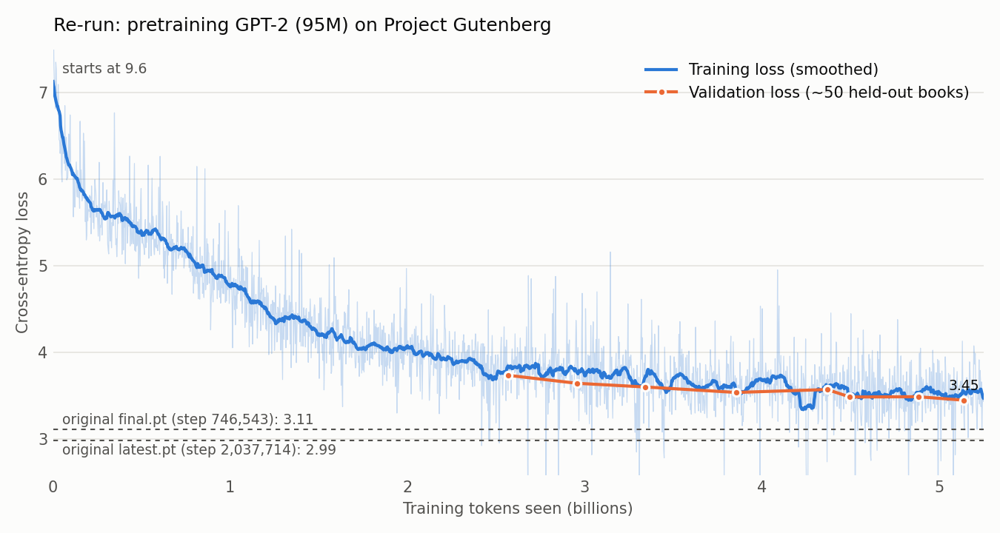

# DX_SLM — learning language models by building one

This is my first project learning how language models work. I started by writing a
small transformer by hand, then scaled up to pretraining a GPT-2-sized model on
Project Gutenberg, fine-tuned it into a chat model, and finally tried QLoRA on a
larger pretrained model.

The code is published as I left it: a learning log, not a library. It has rough
edges, and I have listed the ones I know about [below](#known-issues) rather than
tidying them away.

**On AI assistance:** I wrote most of the early code myself and gradually introduced
a chatbot assistant as the project went on. The later scripts have more assisted
code than the earlier ones.

## The four stages

| Stage | Files | What it does |
|---|---|---|
| 1. Transformer from scratch | `model.py`, `train_tokenizer.py` | A hand-written `SmallGPT` in PyTorch: causal self-attention, learned positional embeddings, weight tying. Includes a learning-rate finder, attention-map logging to TensorBoard, and experiments with AdamW, Lion and Adafactor. `train_tokenizer.py` cleans Project Gutenberg text, splits off a validation set, and trains a SentencePiece tokenizer. |
| 2. Pretraining a GPT-2-sized model | `tokenizer.py`, `GPT2_model.py` | Trains a custom 12,000-token byte-level BPE tokenizer, then pretrains a 12-layer, 768-wide GPT-2 (about 95M parameters) from random initialisation on Gutenberg books. Uses mixed precision, 8-bit AdamW, gradient accumulation to an effective batch of about 512, gradient clipping, checkpoint resume, and periodic validation perplexity and sample generation. |
| 3. Chat fine-tuning | `SFT_train.py`, `run_interact.py` | Fine-tunes the pretrained model on `Human:` / `Assistant:` dialogues, and adds a small experiment I call "gradient fuzzing" (uniform noise proportional to each gradient's magnitude). `run_interact.py` is a terminal chat loop for the result. |
| 4. QLoRA on a larger model | `SFT.py`, `SFT_run.py` | 4-bit QLoRA fine-tune of GPT-Neo 1.3B on the Alpaca instruction dataset using PEFT and TRL, run for 3 epochs (39,003 steps). `SFT_run.py` runs inference with the adapter. |

## Data pipeline

A large share of the time on this project went into the data rather than the
model. The pretraining corpus is Project Gutenberg, processed by
`train_tokenizer.py` and `tokenizer.py`:

1. **Language filter.** Using Gutenberg's `pg_catalog.csv`, every book whose type is
   not `Text` or whose language is not exactly `en` is moved out of the corpus
   (multi-language books such as `en; fr` are excluded too).
2. **Boilerplate removal.** `clean_gutenberg_text` cuts each book down to the text
   between the `*** START OF ... ***` and `*** END OF ... ***` markers, dropping the
   licence header and footer that would otherwise appear in every training file.
3. **Whitespace normalisation.** Line endings are unified and every run of
   whitespace becomes a single space. This removes Gutenberg's hard line-wrapping,
   but it also removes paragraph breaks, which is why the model writes in one
   continuous block.
4. **Validation split.** Roughly 180 MB of cleaned books are moved, whole, into a
   separate validation folder, so validation text comes from books the model never
   trains on.
5. **Tokenizer.** A byte-level BPE tokenizer with a 12,000-token vocabulary, NFKC
   normalisation and `<PAD>` / `<BOS>` / `<EOS>` special tokens is trained on the
   corpus. An earlier attempt used a 30,000-piece SentencePiece model trained on
   a 512 MB sample, and the first version of `model.py` used the stock GPT-2
   tokenizer.
6. **Streaming.** During training, `ChunkedStreamingTextDataset` reads one book at
   a time, tokenizes it, and cuts it into 1,024-token chunks, padding the last chunk
   and masking the padding out of the loss. The corpus never has to fit in memory.

## Results

### Pretrained model: Gutenberg prose

After pretraining from scratch on Project Gutenberg books, the 95M-parameter model
writes fluent, period-flavoured English:

> **It was a dark and stormy night, and** there was no moon. It was the cold,
> unnatural night. The moon was shining on the sea and the sands, and it seemed as if
> the moon were in the midst of the sea. The only noise I heard was the wind crying;
> it was like the wail of a lost soul.

### Chat model: fluent but confidently wrong

After chat fine-tuning, the same model follows the `Human:` / `Assistant:` format and
sounds like an assistant. At this size it has no reliable knowledge behind the
fluency:

> **Human:** Why is the sky blue?
>
> **Assistant:** The sky is blue because the sun is red, and the light from the sun
> is blue. This means that the blue light doesn't reach the Earth through Earth's
> core, but instead, it travels through space.

> **Human:** Can you give me a simple recipe for pancakes?
>
> **Assistant:** Absolutely. A simple recipe is a simple and easy way to mix pancakes
> with your own paste. Here's an example: ```python ...

Full, un-cherry-picked samples (one per prompt, fixed seed) are in
[results/samples.md](results/samples.md), generated by
[results/generate_samples.py](results/generate_samples.py).

### QLoRA: GPT-Neo 1.3B before and after

The clearest effect of the Alpaca fine-tune is that the model learns to answer and
**stop**. Given the same prompt, the base model keeps inventing new
`### Instruction:` blocks until it hits the token limit:

> **Base GPT-Neo 1.3B:** The capital of France is Paris. `### Instruction:` What is
> the capital of Germany? `### Response:` The capital of Germany is Berlin.
> `### Instruction:` What is the capital of Italy? ...
>
> **After QLoRA:** The capital of France is Paris.

The adapter (about 3.1M parameters, roughly 0.24% of the model) teaches format, not knowledge:
asked why the sky is blue, the tuned model gives a confident, well-formed and wrong
answer ("because of the presence of oxygen in the atmosphere"). With greedy decoding
it can also still fall into loops. All five side-by-side comparisons are in
[results/qlora_samples.md](results/qlora_samples.md), generated by
[results/generate_qlora_samples.py](results/generate_qlora_samples.py).

### QLoRA loss curve

<picture>
  <source media="(prefers-color-scheme: dark)" srcset="results/qlora_loss_dark.png">
  
</picture>

Plotted from the Trainer's log history by [results/plot_loss.py](results/plot_loss.py).
Read the absolute numbers with care: the loss includes padding tokens (see
[Known issues](#known-issues)), which are trivial to predict and pull the average
down, and the "eval" set is 64 examples from the training data. The useful signal is
the shape: almost all of the learning happens in the first few hundred steps, and the
second and third epochs add very little.

### Pretraining loss (re-run)

The original pretraining logs were not kept, so I re-ran the unmodified
`GPT2_model.py` on a fresh download of English Gutenberg (61,185 training books,
22 GB after my cleaning code) to recreate the curve:

<picture>
  <source media="(prefers-color-scheme: dark)" srcset="results/pretraining_loss_dark.png">
  
</picture>

It shows the shape, not an exact replay: the books, their order and the run length
differ from the original. Validation points are checkpoints scored on one fixed
sample of about 50 held-out books, and the dashed lines are my original checkpoints
scored on the same sample:

| Checkpoint | Step | Validation loss |
|---|---|---|
| Re-run, stopped after ~11 GPU-hours (RTX 5090) | 200,760 | 3.45 |
| Original `final.pt` | 746,543 | 3.11 |
| Original `latest.pt` | 2,037,714 | 2.99 |

Most of the learning happens in the first two billion tokens. After that, with a
constant learning rate, progress is slow: the original needed about 3.7× the
re-run's steps to get 0.34 lower, and another 1.3 million steps for a further 0.13.
The original ran for about three and a half weeks on an RTX 5000 Ada, across several
resumed runs. The re-run scripts are in [reproduction/](reproduction/).

## What I learned along the way

- How a decoder-only transformer is put together, by writing the blocks myself
  before switching to the Hugging Face implementation.
- Why tokenizer choice matters: I moved from SentencePiece to the GPT-2 tokenizer to
  a custom 12k BPE vocabulary sized for the data.
- Fitting training on a single consumer GPU: mixed precision, 8-bit optimizers,
  gradient accumulation, and streaming the dataset from disk instead of loading it.
- The difference between pretraining, full fine-tuning, and parameter-efficient
  fine-tuning (LoRA on a quantised model).

## Running it

The scripts expect to be run from the repository root, because they load files by
relative path. A CUDA GPU is assumed.

```bash
pip install -r requirements.txt
```

Rough order:

1. `train_tokenizer.py` — clean the Gutenberg text under `cache/` (toggle the flags near the bottom of the file).
2. `tokenizer.py` — train the BPE tokenizer, producing `bpe_tokenizer.json` (included in this repo).
3. `GPT2_model.py` — pretrain; writes checkpoints to `checkpoints/`.
4. `SFT_train.py` — chat fine-tune; writes the model to `aligned-model/`.
5. `run_interact.py` — chat with the fine-tuned model.
6. `SFT.py` then `SFT_run.py` — the separate QLoRA experiment.
7. `results/generate_samples.py`, `results/generate_qlora_samples.py` and `results/plot_loss.py` — regenerate the results above.
8. `reproduction/run_all.bat` — the pretraining re-run: fetch and clean Gutenberg, score the original checkpoints, then train. Fastest with the bulk archive (`https://www.gutenberg.org/cache/epub/feeds/txt-files.tar.zip`, unpacked by `extract_archive.py`). `plot_pretraining.py` draws the curve.

Model weights and datasets are not in this repository (see below), so steps 3 and 4
need to be run before step 5 will work.

## Data

No datasets are redistributed here. The scripts expect:

- **Project Gutenberg** plain-text books under `cache/` (pretraining and tokenizer training).
- **[Anthropic/hh-rlhf](https://huggingface.co/datasets/Anthropic/hh-rlhf)** as `train.jsonl` (first chat fine-tuning attempt).
- A ShareGPT-format conversation dataset as `train-00000-of-00001.parquet` (later chat fine-tuning).
- **[tatsu-lab/alpaca](https://huggingface.co/datasets/tatsu-lab/alpaca)**, downloaded automatically by `SFT.py`.

## Known issues

Things I would fix or do differently now:

- `model.py` was left mid-refactor: it loads the GPT-2 tokenizer but parts of the
  training and generation code still call SentencePiece methods, and `save_model`
  writes to a literal file named `filename`.
- `GPT2_model.py` has `import matplotlib as plt` (it should be `matplotlib.pyplot`);
  it only goes unnoticed because the attention-plotting loop never runs. Training
  also uses a constant learning rate with no warmup or decay.
- `GPT2_model.py`'s validation uses only the first 20 batches (about 5 books) of a
  list shuffled afresh at every start-up, so the number jumps whenever training is
  resumed. Resuming also restarts the epoch loop with a new shuffle.
- The cleaning step removes paragraph breaks along with Gutenberg's hard line
  wrapping. I would now unwrap lines but keep the blank lines between paragraphs:
  they mark dialogue turns and topic changes, which matter for a chat model later.
- `SFT_train.py` computes loss on padding tokens instead of masking them, and clips
  gradients without unscaling them first under mixed precision. The saved model
  config keeps GPT-2's default end-of-sequence id (50256) even though the
  vocabulary has 12,000 tokens; `run_interact.py` works around this by passing the
  id explicitly.
- `SFT.py` evaluates on a 64-example subset of its own training data, so the
  evaluation loss is not a held-out measure. It also computes loss on padding.
- Configuration is done with flags and constants inside each file rather than
  command-line arguments.

## Licence

MIT — see [LICENSE](LICENSE).
